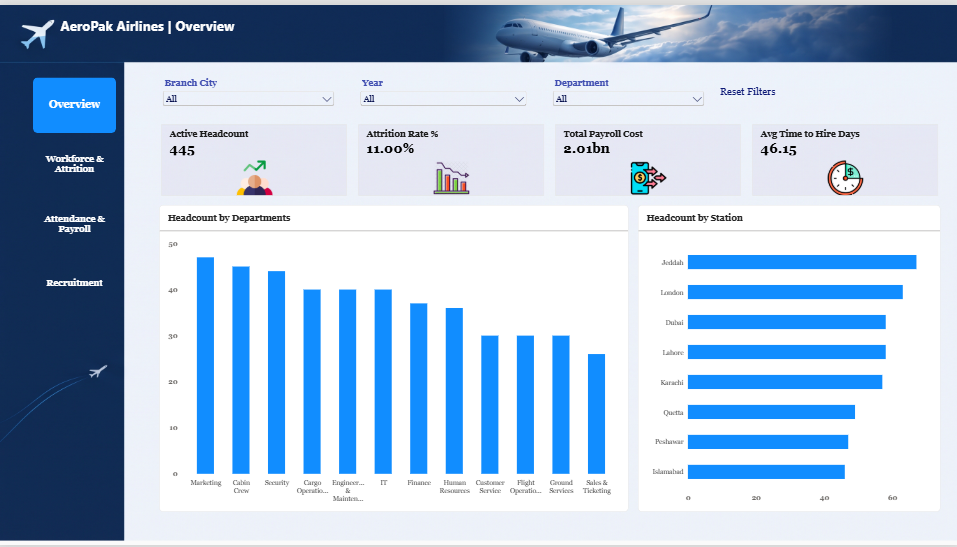
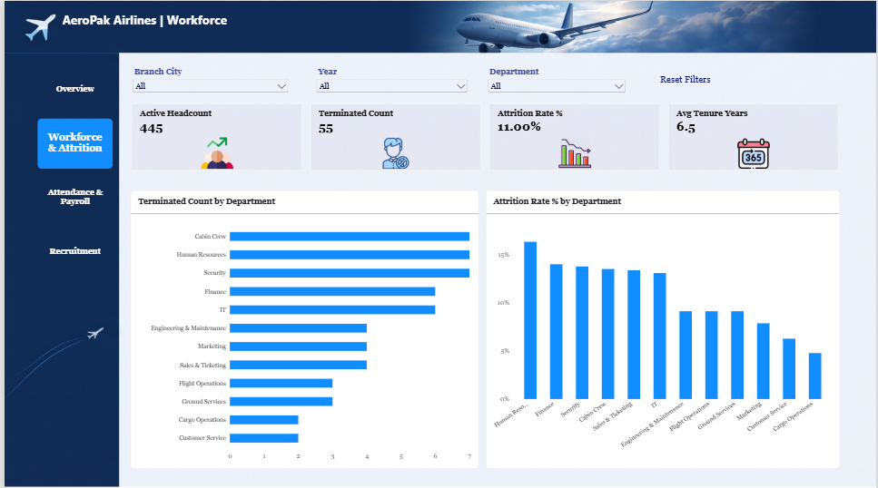
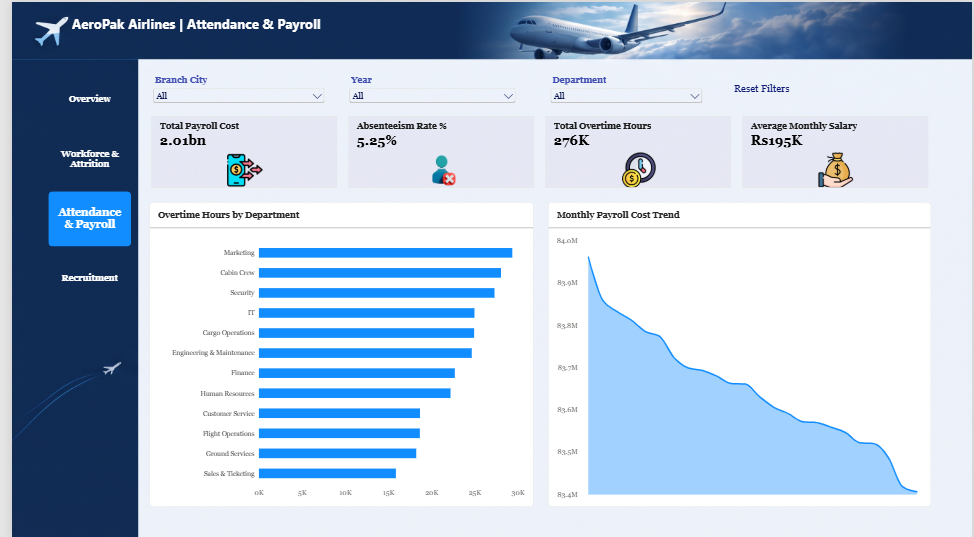
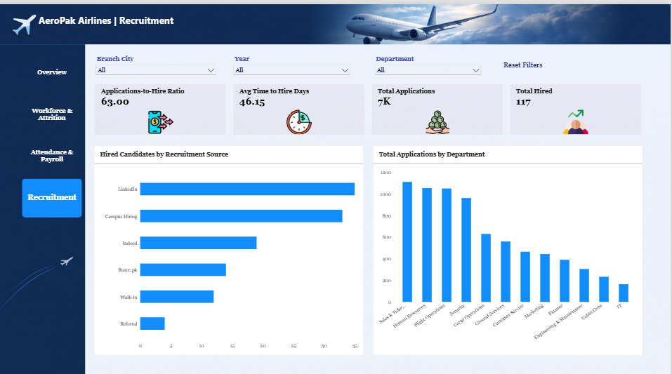

# AeroPak Airlines — HR & Workforce Analytics

A 4-page Power BI report analyzing workforce distribution, attrition drivers, attendance and overtime patterns, monthly payroll costs, and recruitment efficiency across 12 departments and 8 airline bases.

## Dashboard Preview

## 1. Data Cleaning & Transformation (Power Query)
* **Key Standardization:** Unified mixed `EmployeeID` formats (`emp0001`, `2007`, `EMP-0003`) into a consistent `EMP-XXXX` key across `Dim_Employee`, `Fact_Attendance`, and `Fact_Payroll`.
* **Deduplication & Orphan Removal:** Removed 6 exact duplicate and 3 near-duplicate rows in `Dim_Employee` (509 raw → 500 unique employees) and filtered out 8 orphaned rows in `Fact_Attendance` that had no matching employee record.
* **Text & Category Standardization:** Normalized `Gender` (`M`/`male` → `Male`, `F`/`female` → `Female`), `EmploymentType` (`PART TIME`, `full time`, `Contractual`), `Source` (`linkedin` → `LinkedIn`, `REFERRAL` → `Referral`), and proper-cased `FullName`.
* **Numeric & Outlier Fixes:** Converted text-formatted salaries (`227,139.00`) to decimal numbers and removed 5 invalid weekly attendance records where `DaysPresent > 7`.

## 2. Data Model
* **Fact Tables:** `Fact_Attendance` (46,293 rows), `Fact_Payroll` (10,683 rows), `Fact_Recruitment` (60 requisitions)
* **Dimension Tables:** `Dim_Employee` (500 rows), `Dim_Department` (12), `Dim_Designation` (17), `Dim_Branch` (8 stations), and `Dim_Date`
* **Measures Table:** Dedicated `_Measures` table organizing all KPIs

## 3. Core DAX Measures (`_Measures`)
* **Active Headcount:** `CALCULATE(COUNTROWS(Dim_Employee), Dim_Employee[IsActive] = "Y")`
* **Terminated Count:** `CALCULATE(COUNTROWS(Dim_Employee), Dim_Employee[IsActive] = "N")`
* **Attrition Rate %:** `DIVIDE([Terminated Count], COUNTROWS(Dim_Employee), 0)`
* **Avg Tenure Years:** `AVERAGEX(Dim_Employee, DATEDIFF(Dim_Employee[HireDate], COALESCE(Dim_Employee[ExitDate], TODAY()), DAY) / 365.25)`
* **Total Payroll Cost:** `SUM(Fact_Payroll[NetPay])`
* **Average Monthly Salary:** `AVERAGE(Dim_Employee[BaseMonthlySalary])`
* **Total Overtime Hours:** `SUM(Fact_Attendance[OvertimeHours])`
* **Total Applications:** `SUM(Fact_Recruitment[ApplicationsReceived])`
* **Total Hired:** `SUM(Fact_Recruitment[Hired])`
* **Applications-to-Hire Ratio:** `DIVIDE([Total Applications], [Total Hired], 0)`
* **Avg Time to Hire Days:** `AVERAGE(Fact_Recruitment[TimeToHire_Days])`

## 4. Key Findings
* **Overview:** 445 active staff across 12 departments and 8 stations (led by Jeddah with 67 and London with 63).
* **Workforce & Attrition:** 11.0% overall attrition (55 exits); highest in Human Resources (16.3%) and Finance (14.0%), lowest in Cargo Operations (4.8%).
* **Attendance & Payroll:** PKR 2.01B cumulative 24-month payroll, PKR 194,988 average monthly salary, and 275,653 total overtime hours.
* **Recruitment:** 7,371 applications → 117 hires (63:1 ratio, 46.1 days avg time-to-hire), led by LinkedIn (35 hires) and Campus Hiring (33 hires).
