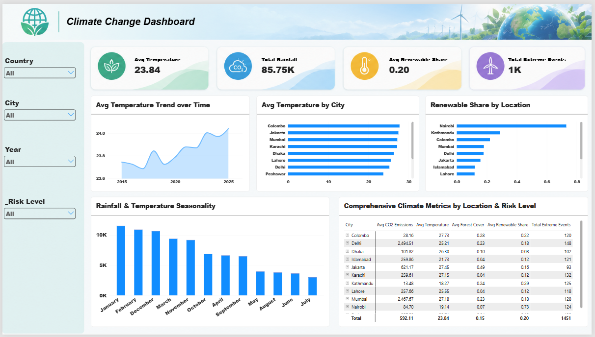

# Climate Change Dashboard (Class Activity)

A guided lab activity built during the atomcamp Data Analytics Bootcamp to practice Power Query cleaning, star-schema modeling, DAX measures, and slicer interactivity on multi-year climate indicators (2015–2025).

## 1. Data Cleaning & Model Setup
* **Power Query:** Removed 1 duplicate observation (`1,585` → `1,584` rows), validated null entries in `Rainfall_mm` and `Renewable_Energy_Share_pct`, trimmed text fields, and assigned proper date and decimal types.
* **Data Model:** Connected `Climate Observations` (fact) to `Locations` (`Location_ID`) and `Date Table` (`Date`) using one-to-many single-direction relationships, plus a `_Measures` table.

## 2. DAX Measures (`_Measures`)
* **Avg Temperature:** `AVERAGE('Climate Observations'[Avg_Temperature_C])`
* **Total Rainfall:** `SUM('Climate Observations'[Rainfall_mm])`
* **Avg CO2 Emissions:** `AVERAGE('Climate Observations'[CO2_Emissions_Index_Mt])`
* **Avg Renewable Share:** `AVERAGE('Climate Observations'[Renewable_Energy_Share_pct])`
* **Avg Forest Cover:** `AVERAGE('Climate Observations'[Forest_Cover_pct])`
* **Total Extreme Events:** `SUM('Climate Observations'[Extreme_Weather_Events])`

## 3. Summary of Visuals & Observations
* **KPI Cards & Slicers:** Displays overall metrics (`23.84°C` avg temp, `85,749.5 mm` total rainfall, `20.21%` avg renewable share, `1,451` extreme weather events) filterable by `Country`, `City`, `Year`, and `Climate_Risk_Level`.
* **Trends & Comparisons:** Tracks warming from `23.74°C` (2015) to `24.04°C` (2025), contrasts coastal heat (Colombo `27.73°C`, Jakarta `27.45°C`) with cooler highland and mountain stations (Quetta `16.70°C`, Kathmandu `18.27°C`), and highlights Nairobi's `72.99%` renewable energy share.
